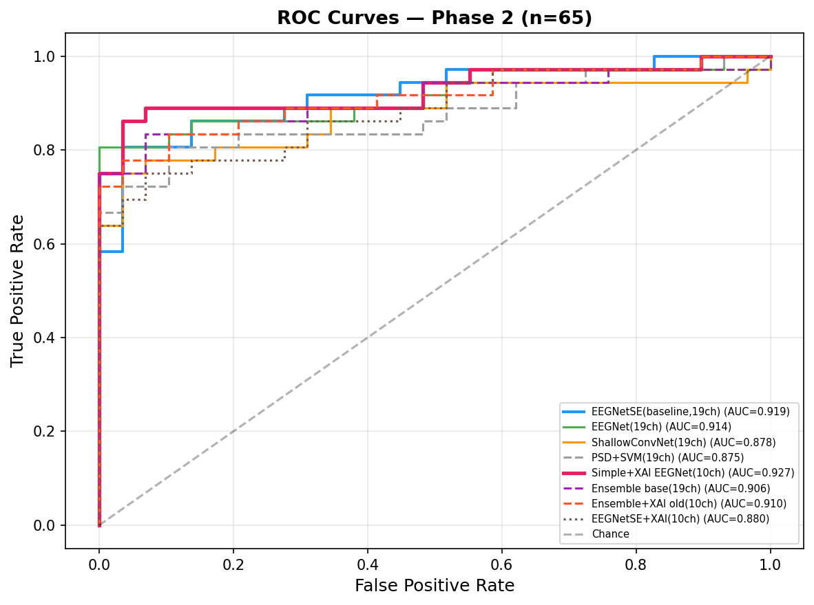
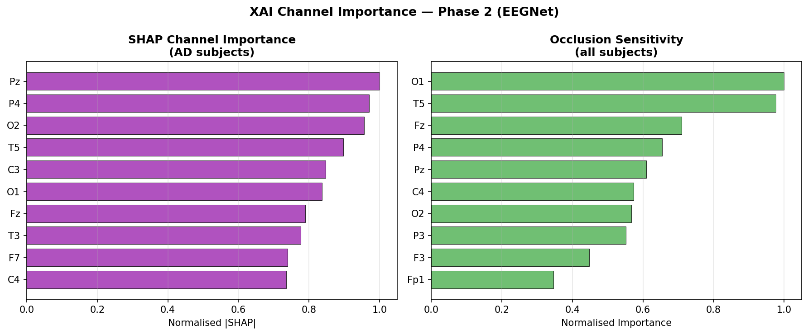
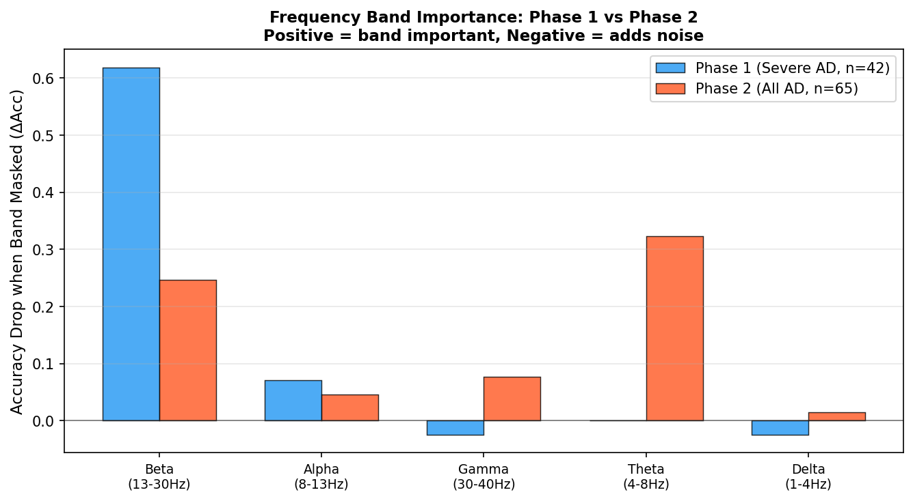
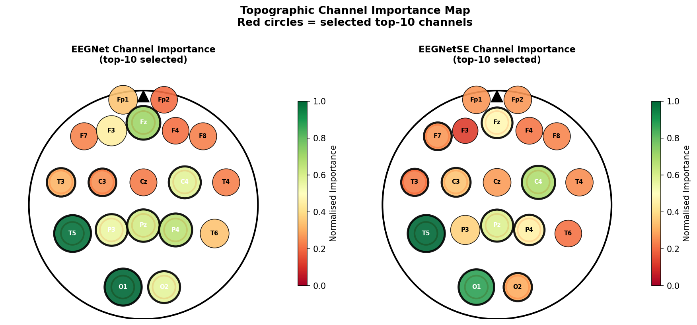
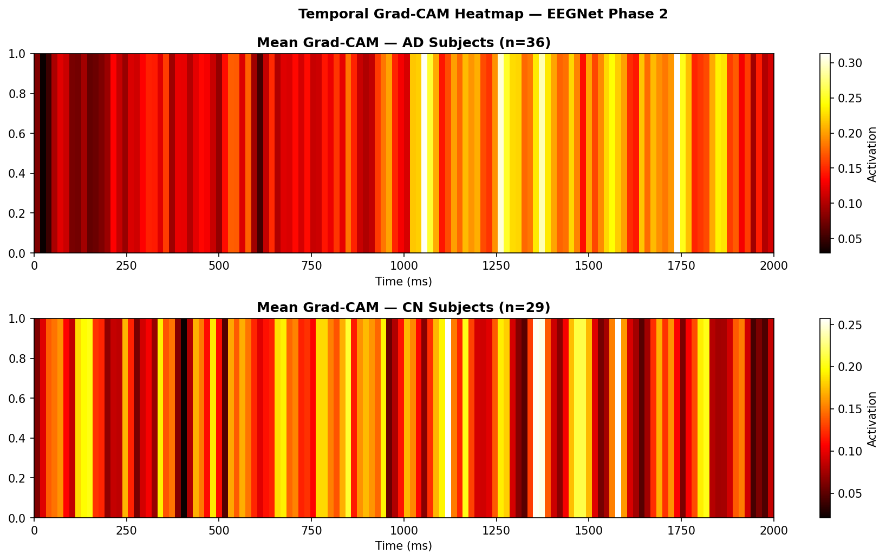

# Severity-Aware EEG Classification of Alzheimer’s Disease Using Explainable AI

---

## 🔴 Live Demo
**[Try the Streamlit App →](https://eeg-alzheimers-demo.streamlit.app)**

Browse the 65-subject cohort and see each subject's leave-one-subject-out prediction, with XAI channel importance and biomarker analysis.

---

## Overview

This repository contains the full Phase 2 research code and results for EEG-based Alzheimer's disease (AD) detection using a two-phase methodology:

- **Phase 1** (n=42, severe AD only): EEGNet-SE with Squeeze-and-Excitation attention achieves **AUC = 0.950**
- **Phase 2** (n=65, all severity stages): XAI-guided channel selection (SHAP + occlusion) with EEGNet reaches **AUC = 0.927** with only 10 electrodes (exploratory; see the notes below)

All models are evaluated with Leave-One-Subject-Out Cross-Validation (LOSO-CV), so no subject's data is used to train the model that tests it. See the notes below for the limitations.

---

## Key Results

| Model | Channels | Params | AUC |
|---|---|---|---|
| EEGNet-SE (Phase 1) | 19 | 1,954 | 0.950 |
| EEGNet+XAI 10ch (Phase 2) | 10 | 1,746 | 0.927 |
| EEGNet-SE (Phase 2) | 19 | 1,954 | 0.919 |
| EEGNet (Phase 2) | 19 | 1,890 | 0.914 |
| DeepConvNet | 19 | 154,802 | 0.873 |

**Notes on evaluation**
- AUC does not depend on a decision threshold. Sensitivity and specificity do, and the thresholds in the notebook were tuned on the pooled LOSO predictions, which makes them optimistic, so they are not shown above. At a fixed threshold of 0.5, the 10-channel model classifies 56 of 65 subjects correctly (accuracy 86.2%, sensitivity 77.8%, specificity 96.6%).
- The 10 channels were ranked with SHAP and occlusion on a model trained on most subjects and applied to all 65. Channel selection therefore happened outside the LOSO loop, so the 10-channel result is exploratory and may be optimistic.
- The AUC differences between EEGNet, EEGNet-SE and the 10-channel model in Phase 2 are not statistically significant (DeLong p ≥ 0.44).
- The band ablation used one model trained on most of the 65 subjects, so it shows what the model relies on, not how well it generalises.

---

## XAI-Selected Top-10 Channels

T5, O1, P4, Pz, O2, Fz, C4, P3, C3, T3. Six of the 10 are posterior or parieto-temporal, which is consistent with the parieto-temporal changes reported in AD. The ranking was computed on all subjects (see notes).

---

## Key Findings
- With 10 XAI-ranked channels, EEGNet's AUC went from 0.914 to 0.927, while EEGNet-SE's fell from 0.919 to 0.880. Neither change is statistically significant, but the pattern suggests that hard channel pruning and SE attention may not combine well.
- Theta (4–8 Hz) has little effect for severe AD but becomes important once moderate AD subjects are included (band ablation ΔAcc = 0.323; see notes).
- DeepConvNet (155k parameters) labels every subject as AD at the default threshold, while compact models with under 2k parameters work well on this small cohort.
- A 10-electrode montage performed on par with the 19-channel models (AUC 0.927 vs 0.914–0.919). This points to a cheaper recording setup, but it needs confirmation with channel selection inside each fold.

---

## Follow-up work
My follow-up project on the same dataset is **EpochSpec**, a lightweight epoch-level spectral classifier for detecting Alzheimer's disease and frontotemporal dementia from EEG. Every data-dependent step is fitted on the training subjects only, inside each fold of a fully nested leave-one-subject-out evaluation. It is under review at IEEE ESCI 2027, and the code will be released after the review.

---

## Result Figures

| ROC Curves | XAI Channel Importance |
|---|---|
|  |  |

| Frequency Band Ablation | Topographic Map |
|---|---|
|  |  |

| GradCAM Temporal Saliency |
|---|
|  |

---

## Repository Structure

```
eeg-alzheimers/
├── app.py                          # Streamlit demo application
├── requirements.txt                # Python dependencies
├── notebooks/
│   └── severity_aware_eeg_alzheimers_xai.ipynb  # Full Phase 2 notebook
└── figures/                        # All result figures from Phase 2
    ├── p2_fig1_baseline_comparison.png
    ├── p2_fig2_roc_curves.png
    ├── p2_fig4_xai_channels.png
    └── ... (14 figures total)
```

---

## Dataset

**OpenNeuro ds004504** — Scalp EEG recordings of Alzheimer's disease, frontotemporal dementia and healthy subjects.

- 88 subjects: 29 CN, 36 AD, 23 FTD
- 19-channel, 10-20 system, resting-state eyes-closed
- CC0 licence (public domain)

```
https://openneuro.org/datasets/ds004504
```

---

## Reproducing Results

### Option 1 — Full reproduction from raw data
1. Clone this repository
2. Install dependencies: `pip install -r requirements.txt`
3. Download the raw EEG dataset from OpenNeuro:
   ```
   https://openneuro.org/datasets/ds004504
   ```
4. Run `notebooks/severity_aware_eeg_alzheimers_xai.ipynb` from Section 1

### Option 2 — Load saved checkpoints (skip retraining)
1. Clone this repository
2. Install dependencies: `pip install -r requirements.txt`
3. Download the precomputed checkpoints from Kaggle:
   ```
   https://www.kaggle.com/datasets/siddhu2021/eeg-ad-phase2-checkpoints
   ```
4. Place the downloaded `.pkl` files in a folder called `eeg_checkpoints/`
5. Run `notebooks/severity_aware_eeg_alzheimers_xai.ipynb` — the notebook will automatically load from checkpoints and skip retraining

---

## License

Code: MIT License  
Dataset: CC0 (OpenNeuro ds004504)

---

## Acknowledgements
This project started as my undergraduate thesis, supervised by Dr. K. Prabhakar, with Kaleru Akhila and Dr. Prasad Chetti as co-authors on the manuscript.
